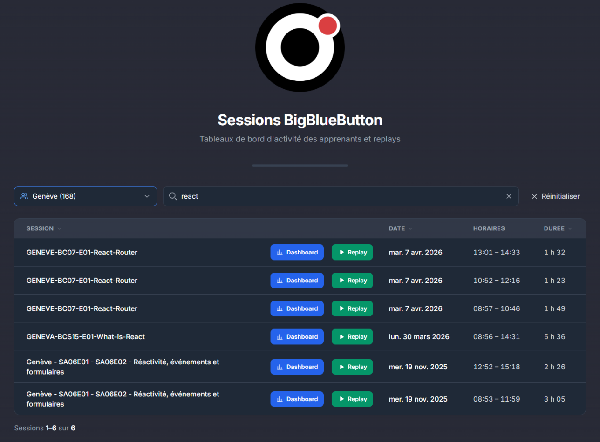

# bbb-session-insights

Open source AGPLv3 software for BigBlueButton session analysis.

## Description

**bbb-session-insights** is a project initially aimed at listing all training sessions for O'clock promotions taking place on BigBlueButton (BBB). It is now open source and available to everyone. This dashboard allows users to easily view and track all current and past training sessions, as well as obtain details on each session:
- Learning dashboard (can be accessed and downloaded after the session has ended)
- Recordings (called Replays)
- Video (*planned*)
- Chat messages (*planned*)



## Setup

### Requirements

- Node.js >= 18.17 and npm (for running without Docker)
- Docker Engine with Compose support (recommended)

### Installation

1. Clone the repository:
    ```bash
    git clone https://github.com/O-clock-Dev/bbb-session-insights.git
    cd bbb-session-insights
    ```
2. Generate the NextAuth secret:
    ```bash
    openssl rand -base64 32
    ```
3. Create a `.env` file:
    * Start from [`.example.env`](.example.env).
    * See the [Configuration](#configuration) section for details on each variable.

### Configuration

#### env file

> Next.js supports [several env files, loaded in a defined order of priority](https://nextjs.org/docs/pages/building-your-application/configuring/environment-variables).

* See [`.example.env`](.example.env).
* OIDC Keycloak configuration
    * `SKIP_KEYCLOAK=true`: disables OIDC authentication (see [SSO](#sso)).
    * `KEYCLOAK_CLIENT_ID="client-id"`: Keycloak OIDC client ID, see the [Keycloak documentation](https://www.keycloak.org/docs/latest/server_admin/#_identity_broker_oidc).
    * `KEYCLOAK_CLIENT_SECRET="secret"`: Keycloak OIDC client secret.
    * `KEYCLOAK_ISSUER="https://auth.mydomain.io/realms/myrealm"`: URL of your Keycloak realm.
* NextAuth configuration (see [options](https://next-auth.js.org/configuration/options))
    * `NEXTAUTH_URL="http://localhost:3000"`: canonical URL of your site. When `NEXT_PUBLIC_BASE_PATH` is set, NextAuth does not pick it up on its own: use the full path to the auth routes instead, e.g. `http://localhost:3000/bsi/api/auth`.
    * `NEXTAUTH_SECRET="<output from openssl rand -base64 32>"`: used to encrypt the NextAuth.js JWT and to hash email verification tokens.
* Next.js
    * `NEXT_PUBLIC_BASE_PATH="/bsi"`: optional URL path prefix, used to serve the application under a sub-path behind a reverse proxy. Leave empty to serve it at the root. This value is applied **at build time**: rebuild the application (or the Docker image) after changing it.
* Application configuration
    * `LEARNING_DASHBOARD_FOLDER="/folder/learning-dashboard"`: location of the BBB learning dashboard folder.
    * `LEARNING_DASHBOARD_BASEURL="https://bbb.mydomain.school"`: URL of the BBB server, used to build the public links to session data.
    * `REPLAYS_FOLDER="/folder/published/presentation"`: location of the BBB recordings folder.
    * `COURSES_CACHE_TTL=300`: optional, how long (in seconds) the session list is kept in memory before the folders are scanned again. Defaults to `300`. New sessions can take up to this long to appear. The first scan after startup reads every dashboard file, starting with the most recent meetings so that they are listed right away; later scans run in the background while the previous list is still served, and only read the new or modified files.
    * `COURSES_SCAN_CONCURRENCY=4`: optional, how many dashboard files are read at the same time during a scan. Defaults to `4`. Lower it to spread the load of the first scan on the BBB server.

#### SSO

* SSO is optional: set `SKIP_KEYCLOAK=true` to disable OIDC Keycloak authentication. The session list is then accessible without logging in.

#### Local development

> **A dataset is required for local development.**

* For the moment, our dataset is private.
    * We will make it public [in the future](https://github.com/O-clock-Dev/bbb-session-insights/issues/16).
    * Download the private [dataset](https://drive.google.com/file/d/1772JIiIe9WbYtItGNp-nyCT4z0i5AZxK/view?usp=sharing).
* Extract it into a `datas` directory (ignored by git).
* Set `NODE_ENV` to `localdev` to use the local dataset.

#### Development using BBB data

* Check `compose.yaml` and `.example.env`, and mount the `/var/bigbluebutton` subdirectories in the correct destinations.

### Launching

> The preferred method is **Docker**.

* Docker:
    * `docker compose up --build -d`: the application is then available on port `3333`.
* npm (port `3000` by default):
    * `npm run dev`: starts the development server.
    * `npm run build`: builds the application.
    * `npm run start`: starts the built application.

## Usage

* Open your instance at its host and port followed by `NEXT_PUBLIC_BASE_PATH` (e.g. `http://localhost:3000/bsi`), or through your reverse proxy, to browse the data from your BBB sessions.
